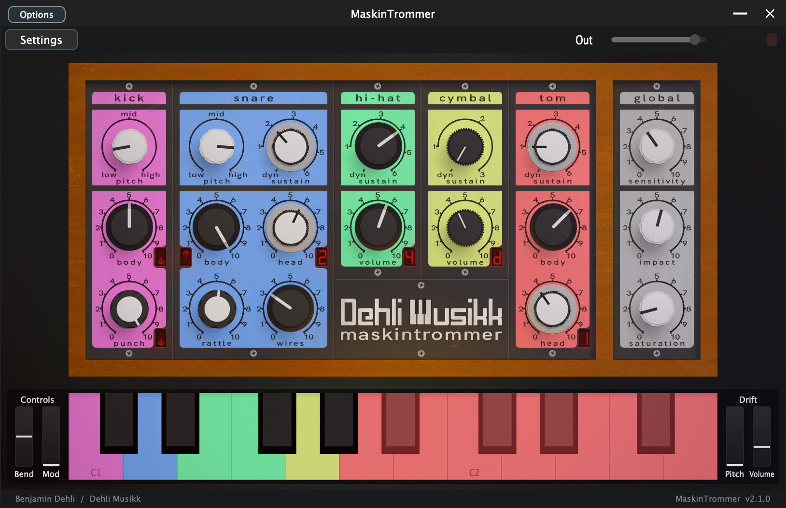
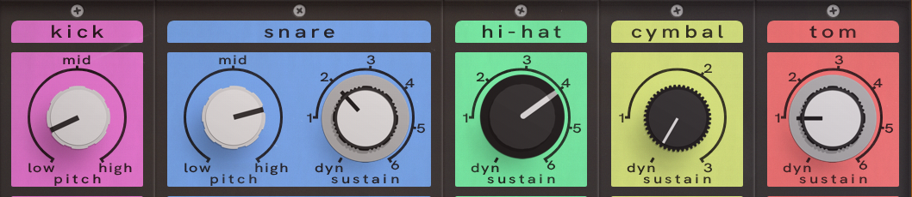
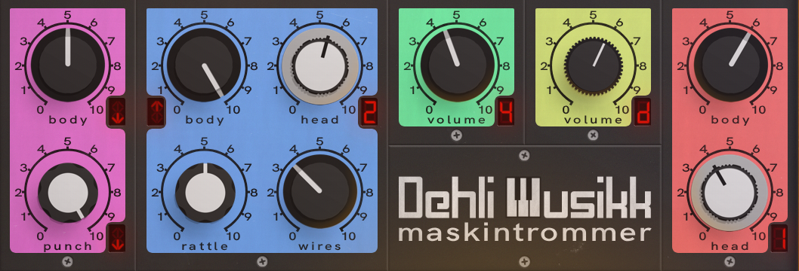
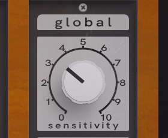
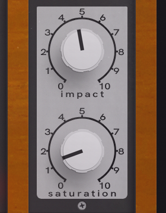
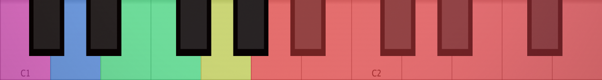
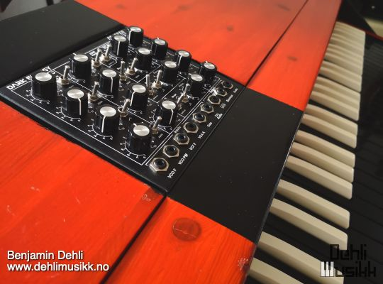
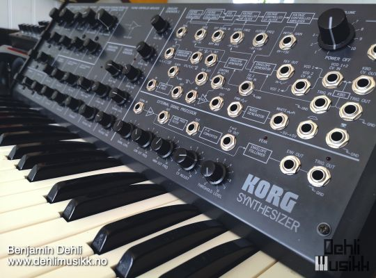
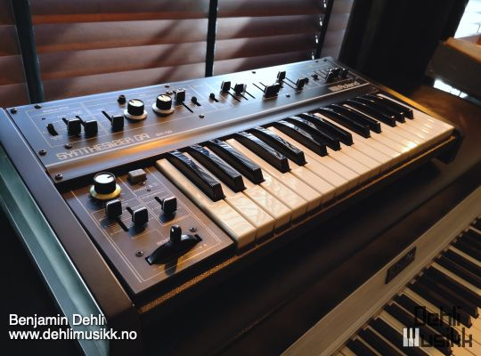
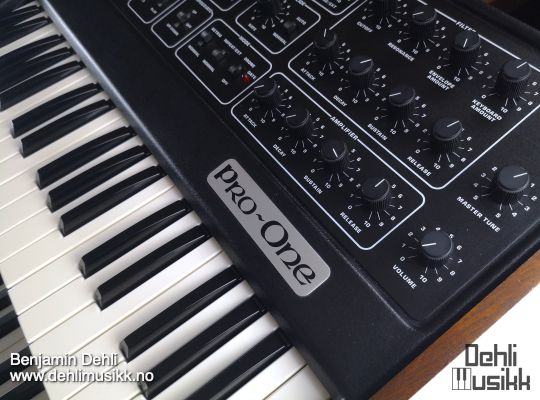

# MaskinTrommer

**[Product page and documentation](https://benjamindehli.github.io/MaskinTrommer/)**

MaskinTrommer is a drum instrument featuring electronic drum sounds created from analog synthesizers. Each drum type contains multiple samples per sound to eliminate the typical "machine gun" effect associated with digital sample based drum machines.

The drum sounds were created using:

- Korg MS-20
- Roland SH-09
- Doepfer Dark Energy
- Sequential Circuits Pro-One

The result is a versatile collection of synthetic kicks, snares, hi-hats, cymbals, and toms with a broad tonal range, from tight and percussive to big and sustaining.

## Release notes

### Version 2.2.0 (2026-11-25)

The changes in this release apply to the plugin version only. The DecentSampler version is unchanged.

- The plugin is now also available for Windows and Linux, as VST3 and Standalone. These versions have not yet been tested on Windows and Linux computers.
- The window can be resized from its own size to twice that, by dragging its bottom-right corner or with the new window size setting in the settings menu. The size is saved with the project.
- Added Undo and Redo buttons. Knob moves, button presses and menu choices can be undone, also with Cmd+Z and Shift+Cmd+Z (Ctrl+Z and Shift+Ctrl+Z on Windows and Linux). Automation is not recorded as steps.
- Every control has a name for screen readers such as VoiceOver, and a screen reader goes through the window in a sensible order.
- The buttons and menus have names in the DAW's automation list instead of numbers. Existing automation of them keeps working.
- If the samples cannot be found, the plugin now says so and where they should be, instead of playing silence.
- The plugin tells the DAW how long its reverb and release tails last, so they are not cut off at the end of an export.
- An optional check for new versions. The first time the plugin opens, it asks whether it may check. It reads one small file from the product page and sends nothing about you. A new version is shown in the bottom strip.
- A damaged value in a saved project or preset is set back to its default instead of reaching the sound.
- Built on JUCE 9.0.6.

### Version 2.1.0 (2026-08-01)

The changes in this release apply to the plugin version only. The DecentSampler version is unchanged.

- Added a translucent overlay graphic on top of the interface.
- Keys that are hovered or held on the keyboard are now shaded in a neutral way instead of turning yellow:
  - White keys turn darker.
  - Black keys turn brighter.
- The computer keyboard keeps playing notes even while you adjust a control with the mouse.
- Whole number controls now snap to each step. Chosen steps can also show a name instead of a number, for example step 0 shows as dynamic, both in the value readout and as automation values in your DAW.

### Version 2.0.0 (2026-07-19)

- Added a plugin version. See the section "The plugin version".
- Added the missing round robins (takes 09 and 10) to the three snare sets.
- Restored the round robin order for the cymbal samples.
- The Impact control now targets its effect by index, fixing the gain binding.
- Removed the unused generic kick tag and some empty leftover blocks.

### Version 1.0.0 (2026-03-01)

- First version released.

## Included formats

- VST3 (macOS, Windows and Linux)
- AU (macOS)
- Standalone application (macOS, Windows and Linux)
- Decent Sampler (macOS, Windows and Linux)

The Windows and Linux versions of the plugin are new and have not yet been tested on those systems.

## The plugin version

The plugin is a self-contained instrument, available as VST3, AU and Standalone.
The graphics are embedded in the plugin, and the samples and impulse responses come in one losslessly compressed file that the installer puts in place, so there is nothing to locate by hand.

The plugin has all the controls and features from the Decent Sampler version, including MIDI learn, the master volume fader with output meter, value readouts for the knobs and full DAW automation.
On top of that, the plugin version adds:

- Drift wheels next to the pitch and modulation wheels, adding a subtle random pitch and volume drift to each voice.
- A velocity curve setting in the settings menu.
- A resizable window, from its own size to twice that.
- Undo and Redo.

## The Decent Sampler version

This version of MaskinTrommer is an instrument preset / sample library for Decent Sampler. If you're new to Decent Sampler, I recommend checking out [this guide][Decent Sampler guide] first.

## Technical specification

|                      | Sample rate | Bit depth | Channels | Number of files | File size |
| -------------------: | ----------: | --------: | -------- | --------------: | --------: |
|   **Samples (Kick)** |      48 kHz |    24 bit | 1 (mono) |              32 |    1.5 MB |
|  **Samples (Snare)** |      48 kHz |    24 bit | 1 (mono) |              78 |   16.5 MB |
| **Samples (Hi-hat)** |      48 kHz |    24 bit | 1 (mono) |              72 |    5.9 MB |
| **Samples (Cymbal)** |      48 kHz |    24 bit | 1 (mono) |              24 |    5.2 MB |
|    **Samples (Tom)** |      48 kHz |    24 bit | 1 (mono) |             136 |   39.3 MB |

## User Interface

||
|:--:|
|Overview|

The interface is divided into two main areas:

- **Left section**: Individual drum controls and sample mixer
- **Right section**: Global settings and effects

The keyboard at the bottom is color-coded to match each drum section, making it easy to identify the mapping.

### Drum Settings

||
|:--:|
|Pitch and sustain controls|

The top row of knobs in each drum section controls the primary sound-shaping parameters.

#### Pitch (Kick & Snare)

- Adjusts the tuning of the drum.
- Turning clockwise raises the pitch.
- Turning counterclockwise lowers the pitch.
- Affects both sample types for the kick and the "body" samples for the snare.

#### Sustain (Snare, Hi-Hat, Cymbal, Tom)

- Controls which sustain-length samples are triggered.
  - For snare and tom, it only affects the "head" samples.
- Lower values select shorter, tighter sounds.
- Higher values select longer sustaining samples.
- Dyn (Dynamic) mode:
  - Higher MIDI velocity → longer sustaining samples
  - Lower MIDI velocity → shorter sustaining samples

This allows expressive control directly from performance dynamics.

### Drum Mixer

||
|:--:|
|Volume controls|

The second and third rows of knobs in each drum section form the sample mixer.

Each knob controls the volume of a specific sample type for that drum.
The knob design visually represents which synthesizer the samples originate from.

#### Sample Type Blending

- You can blend multiple synthesizer sources for a single drum.
- Each active source contributes its own round robin variations.
- Combining sources dramatically increases variation and complexity.

#### Display Indicators

Some mixer knobs include a small display.
The display shows how the samples assigned to that knob are influenced by either pitch (kick & snare) or sustain (snare, hi-hat, cymbal & tom).

This provides quick visual feedback when shaping the sound.

### Global Settings

||
|:--:|
|Sensitivity control|

Located in the rightmost section.

#### Sensitivity

Controls how strongly MIDI velocity affects sample volume.

- Lower values → More consistent volume regardless of velocity
- Higher values → Greater dynamic range

This allows you to tailor the instrument to your playing style or sequencing needs.

### Global Effects

||
|:--:|
|Impact and saturation controls|

#### Impact

Controls the level of the transient (initial attack) relative to the sustain portion.

- Higher values → Louder attack, quieter sustain
- Lower values → More even balance between attack and body

This is useful for tightening drums or making them cut through a mix.

#### Saturation

A volume-compensated overdrive/distortion effect.

- Adds harmonic content and edge.
- Maintains perceived loudness while increasing intensity.
- Suitable for subtle coloration or more aggressive processing.

### Keyboard Layout

||
|:--:|
|Color-coded keyboard|

The on-screen keyboard is color-coded to match the drum sections:

- Kick (pink): C1
- Snare (blue): D1
- Closed hi-hat (green): E1
- Open hi-hat (green): F1
- Cymbal (yellow): G1
- Tom (red): A1 to G2

This makes it easy to identify which keys trigger which drums, especially during performance.

## Equipment used

|                            Name                            |                                   Image                                    |
| :--------------------------------------------------------: | :------------------------------------------------------------------------: |
|         [Doepfer Dark Energy][Doepfer Dark Energy]         |                  |
|                  [Korg MS-20][Korg MS-20]                  |                                    |
|                [Roland SH-09][Roland SH-09]                |                                |
| [Sequential Circuits Pro-One][Sequential Circuits Pro-One] |  |

## About this repository

This repository contains the source for both the Decent Sampler library (the DecentSampler folder) and the plugin version.
The plugin is a thin wrapper around the shared Dehli Musikk sampler engine, and a converter translates the Decent Sampler library into the engine's native preset format at build time.
The audio files are not part of this repository, since the samples are a paid product.
The full version is available from [store.dehlimusikk.no][Gumroad profile].

[Gumroad profile]: https://store.dehlimusikk.no/
[Decent Sampler guide]: https://www.decentsamples.com/how-to-use-decent-sampler/
[Doepfer Dark Energy]: https://www.dehlimusikk.no/equipment/instruments/doepfer-dark-energy/
[Korg MS-20]: https://www.dehlimusikk.no/equipment/instruments/korg-ms-20/
[Roland SH-09]: https://www.dehlimusikk.no/equipment/instruments/roland-sh-09/
[Sequential Circuits Pro-One]: https://www.dehlimusikk.no/equipment/instruments/sequential-circuits-pro-one/